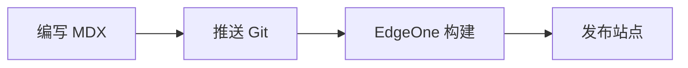

import Tabs from '@theme/Tabs';
import TabItem from '@theme/TabItem';
import {Sandpack} from '@codesandbox/sandpack-react';

# Docusaurus 互动功能实战

Docusaurus 的文档文件使用 MDX。除了 Markdown，你还可以直接使用 React 组件，把普通文章做成可运行、可切换、可交互的知识页面。

本教程按“立即可用”和“需要配置”两部分介绍常用功能。示例均以当前仓库为基础，命令默认在项目根目录执行。

## 开始之前

安装依赖并启动中文开发站点：

```bash
pnpm install
pnpm start --locale zh-Hans
```

浏览器打开 [http://localhost:3000/](http://localhost:3000/)。修改 `docs` 中的文件后，页面通常会自动刷新。

新建教程时，建议使用 `.mdx` 后缀：

```mdx title="docs/tutorial-extras/my-guide.mdx"
---
sidebar_position: 4
sidebar_label: '我的教程'
title: '我的教程'
description: '显示在搜索结果和页面元数据中的简介。'
---

# 我的教程

正文内容。
```

侧边栏由目录结构自动生成。`sidebar_position` 控制同一目录中的排序，目录名称和位置由相邻的 `_category_.json` 控制。

## 1. 提示框、折叠内容和标签页

### 提示框

用提示框区分补充说明、建议、警告和高风险操作：

```md
:::tip[推荐]

先在本地运行生产构建，再推送到远端。

:::

:::warning[注意]

修改文档 ID 或路径会改变页面地址，请同步检查站内链接。

:::
```

实际效果如下：

:::tip[推荐]

先在本地运行生产构建，再推送到远端。

:::

:::warning[注意]

修改文档 ID 或路径会改变页面地址，请同步检查站内链接。

:::

支持的类型包括 `note`、`tip`、`info`、`warning`、`danger` 和 `caution`。

### 折叠内容

适合放答案、长日志或不常用的补充信息：

````mdx
<details>
  <summary>查看完整命令</summary>

  ```bash
  pnpm typecheck
  pnpm build
  ```
</details>
````

<details>
  <summary>查看完整命令</summary>

  ```bash
  pnpm typecheck
  pnpm build
  ```
</details>

### 标签页

标签页适合展示不同包管理器、操作系统或语言的等价步骤。先在文档顶部导入组件：

```mdx
import Tabs from '@theme/Tabs';
import TabItem from '@theme/TabItem';
```

然后添加标签内容：

````mdx
<Tabs groupId="package-manager" defaultValue="pnpm">
  <TabItem value="pnpm" label="pnpm">

  ```bash
  pnpm add clsx
  ```

  </TabItem>
  <TabItem value="npm" label="npm">

  ```bash
  npm install clsx
  ```

  </TabItem>
</Tabs>
````

<Tabs groupId="package-manager" defaultValue="pnpm">
  <TabItem value="pnpm" label="pnpm">

  ```bash
  pnpm add clsx
  ```

  </TabItem>
  <TabItem value="npm" label="npm">

  ```bash
  npm install clsx
  ```

  </TabItem>
</Tabs>

相同 `groupId` 的标签页会记住用户选择。例如用户选过 pnpm，其他包管理器标签组也会优先显示 pnpm。

## 2. 增强代码块

代码块支持文件标题、行号和重点行高亮：

````md
```tsx title="src/components/Counter.tsx" showLineNumbers {4-7}
import {useState} from 'react';

export function Counter() {
  const [count, setCount] = useState(0);
  return (
    <button onClick={() => setCount(count + 1)}>
      点击次数：{count}
    </button>
  );
}
```
````

渲染效果：

```tsx title="src/components/Counter.tsx" showLineNumbers {4-7}
import {useState} from 'react';

export function Counter() {
  const [count, setCount] = useState(0);
  return (
    <button onClick={() => setCount(count + 1)}>
      点击次数：{count}
    </button>
  );
}
```

常用元信息：

| 写法 | 用途 |
| --- | --- |
| `title="文件名"` | 在代码块顶部显示文件名 |
| `showLineNumbers` | 显示行号 |
| `{2,4-7}` | 高亮第 2 行和第 4 至 7 行 |
| `language` | 指定 `ts`、`tsx`、`bash`、`json` 等语法 |

## 3. 在线代码实验 Sandpack

当前项目已经安装 `@codesandbox/sandpack-react`。在 MDX 顶部导入：

```mdx
import {Sandpack} from '@codesandbox/sandpack-react';
```

最小示例：

```mdx
<Sandpack
  template="react"
  theme="auto"
  files={{
    '/App.js': `export default function App() {
  return <h1>Hello Docusaurus</h1>;
}`,
  }}
/>
```

下面是一个可以直接编辑和运行的计数器：

<Sandpack
  template="react"
  theme="auto"
  options={{
    editorHeight: 320,
    showNavigator: true,
    showTabs: true,
  }}
  files={{
    '/App.js': `import {useState} from 'react';
import './styles.css';

export default function App() {
  const [count, setCount] = useState(0);

  return (
    <main>
      <p>当前计数：{count}</p>
      <button onClick={() => setCount((value) => value + 1)}>
        增加
      </button>
      <button onClick={() => setCount(0)}>重置</button>
    </main>
  );
}`,
    '/styles.css': `body {
  font-family: system-ui, sans-serif;
  padding: 24px;
}

button {
  margin-right: 8px;
  padding: 8px 14px;
}`,
  }}
/>

常用配置：

| 属性 | 说明 |
| --- | --- |
| `template` | 运行环境，例如 `react`、`vanilla`、`vue` |
| `files` | 虚拟文件系统，键是文件路径，值是代码 |
| `customSetup.dependencies` | 示例额外依赖及版本 |
| `options.editorHeight` | 编辑器固定高度 |
| `options.showConsole` | 显示控制台 |
| `options.showLineNumbers` | 显示编辑器行号 |

带额外依赖时使用 `customSetup`：

```mdx
<Sandpack
  template="react"
  customSetup={{
    dependencies: {
      clsx: '^2.1.1',
    },
  }}
  files={{
    '/App.js': `import clsx from 'clsx';

export default function App() {
  return <p className={clsx('message')}>Sandpack 示例</p>;
}`,
  }}
/>
```

:::caution[性能建议]

Sandpack 会增加页面 JavaScript 体积。同一篇文章中尽量只放少量实验，普通示例继续使用静态代码块。

:::

## 4. 创建可复用的交互组件

多个文档都要使用同一种 UI 时，把组件放在 `src/components`，不要在每篇 MDX 中重复实现。

```tsx title="src/components/StatusBadge/index.tsx"
import type {ReactNode} from 'react';

type Props = {
  children: ReactNode;
  status?: 'success' | 'warning';
};

export default function StatusBadge({children, status = 'success'}: Props) {
  const color = status === 'success' ? '#18794e' : '#9a6700';
  return <strong style={{color}}>{children}</strong>;
}
```

在任意 MDX 中导入：

```mdx
import StatusBadge from '@site/src/components/StatusBadge';

构建状态：<StatusBadge>成功</StatusBadge>
```

使用 `@site/` 别名可以避免随文档目录深度变化的 `../../` 相对路径。

如果组件依赖浏览器 API（例如 `window` 或 `localStorage`），请使用 `BrowserOnly`，避免服务端构建报错：

```mdx
import BrowserOnly from '@docusaurus/BrowserOnly';

<BrowserOnly fallback={<span>正在加载...</span>}>
  {() => <span>视口宽度：{window.innerWidth}px</span>}
</BrowserOnly>
```

## 5. Mermaid 图表

Mermaid 可以用文本维护流程图、时序图和状态图。当前项目尚未启用，需要先安装与 Docusaurus 相同版本的主题：

```bash
pnpm add @docusaurus/theme-mermaid@3.10.2
```

修改 `docusaurus.config.ts`：

```ts title="docusaurus.config.ts"
const config: Config = {
  markdown: {
    mermaid: true,
  },
  themes: ['@docusaurus/theme-mermaid'],
  // 其他配置保持不变
};
```

之后可在文档中写：

````md title="docs/architecture.mdx"

````

复杂节点文字建议使用引号，例如 `A["包含标点的标题"]`。

## 6. 全文搜索

公开文档可以申请 Algolia DocSearch。拿到应用信息后，在 `themeConfig` 中配置：

```ts title="docusaurus.config.ts"
themeConfig: {
  algolia: {
    appId: process.env.ALGOLIA_APP_ID,
    apiKey: process.env.ALGOLIA_SEARCH_API_KEY,
    indexName: process.env.ALGOLIA_INDEX_NAME,
    contextualSearch: true,
  },
},
```

在本地 `.env.local` 或部署平台环境变量中设置：

```dotenv title=".env.local"
ALGOLIA_APP_ID=your_app_id
ALGOLIA_SEARCH_API_KEY=your_search_only_key
ALGOLIA_INDEX_NAME=your_index_name
```

只使用 Algolia 的 Search-Only API Key，不要把管理密钥放进前端配置或 Git 仓库。

## 7. 版本化与多语言

发布稳定版文档：

```bash
pnpm docusaurus docs:version 1.0
```

命令会生成 `versioned_docs`、`versioned_sidebars` 和 `versions.json`。完整步骤见[管理文档版本](./manage-docs-versions.mdx)。

为新文档补充英文翻译时，保持相同的相对路径：

```text
docs/tutorial-extras/interactive-docs-guide.mdx
i18n/en/docusaurus-plugin-content-docs/current/tutorial-extras/interactive-docs-guide.mdx
```

启动英文站点：

```bash
pnpm start --locale en
```

完整目录结构与语言切换配置见[网站多语言翻译](./translate-your-site.mdx)。

## 8. 发布到 EdgeOne

推送前执行与 CI 接近的检查：

```bash
pnpm install --frozen-lockfile --config.strict-dep-builds=true
pnpm typecheck
pnpm build
```

如果新依赖包含安装脚本，pnpm 会要求审批。执行：

```bash
pnpm approve-builds
```

确认后检查并提交 `pnpm-workspace.yaml`。当前格式示例：

```yaml title="pnpm-workspace.yaml"
allowBuilds:
  '@swc/core': true
  core-js: true
  es5-ext: true
```

只批准经过检查且确实需要运行脚本的依赖，不要使用允许所有构建脚本的全局开关。

## 常见问题

### `window is not defined`

组件在构建期间也会由 Node.js 渲染。将浏览器专用逻辑放进 `BrowserOnly`、`useEffect`，或在事件处理函数中延迟执行。

### `Cannot find module ...`

只要源码直接 `import` 某个包，就应把它声明为项目的直接依赖，即使该包已经作为其他依赖的子依赖存在。

### MDX 解析失败

- JSX 属性使用 `{}`，例如 `<Demo size={3} />`。
- JSX 标签必须闭合。
- 要展示 `<Component>` 原文时，放进反引号或代码块。
- 对象代码中有 `{`、`}` 时，优先放进围栏代码块。

### 本地正常、CI 安装失败

删除“本地缓存成功”这一干扰因素，使用冻结锁文件和严格依赖脚本检查重新安装：

```bash
pnpm install --force --frozen-lockfile --config.strict-dep-builds=true
```

同时确认 `packageManager` 固定版本、`pnpm-lock.yaml` 已提交，以及 `allowBuilds` 使用的是当前 pnpm 支持的格式。

## 推荐检查清单

- 页面标题、描述和侧边栏顺序正确。
- 内部链接使用相对路径并能正常打开。
- 互动组件在亮色和暗色主题下都可读。
- 中文与英文页面路径保持一致。
- `pnpm typecheck` 通过。
- `pnpm build` 能同时生成 `zh-Hans` 与 `en`。
- 新依赖的安装脚本已明确审查和批准。
